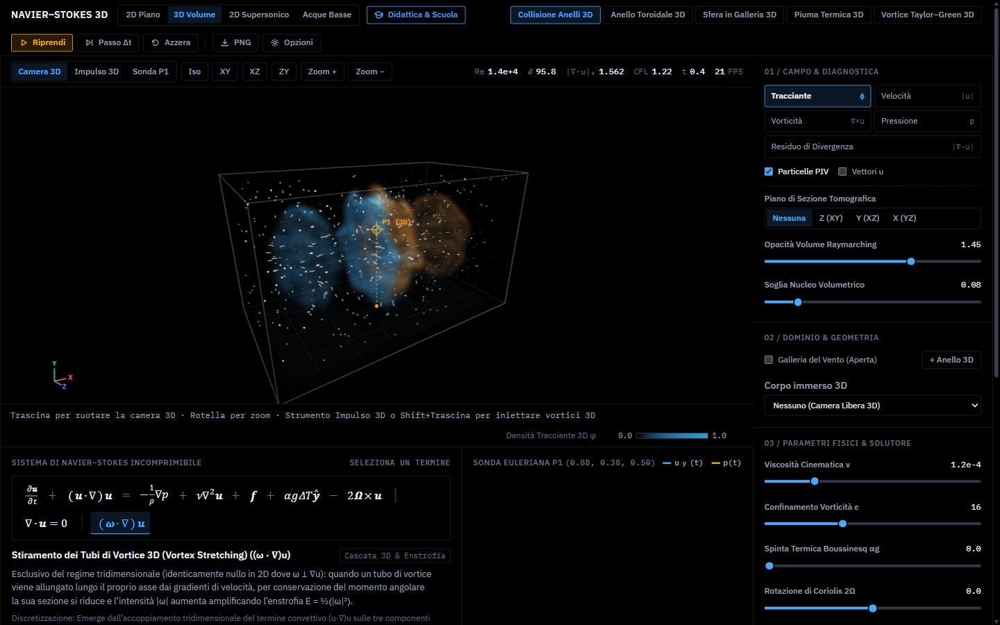
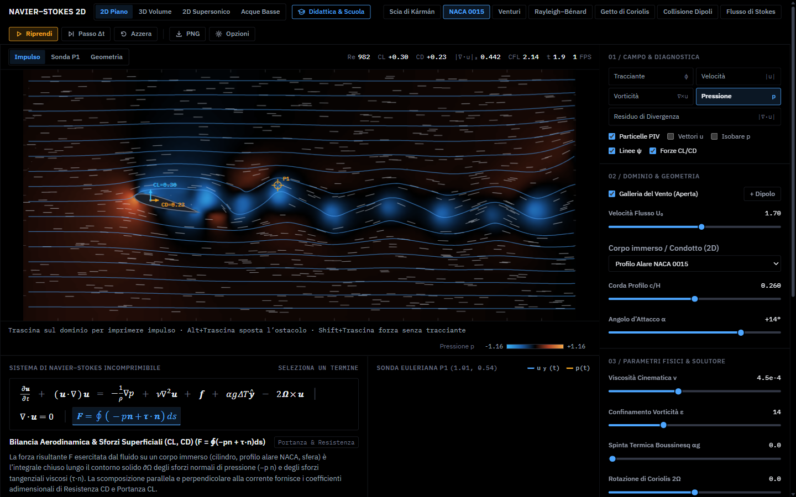
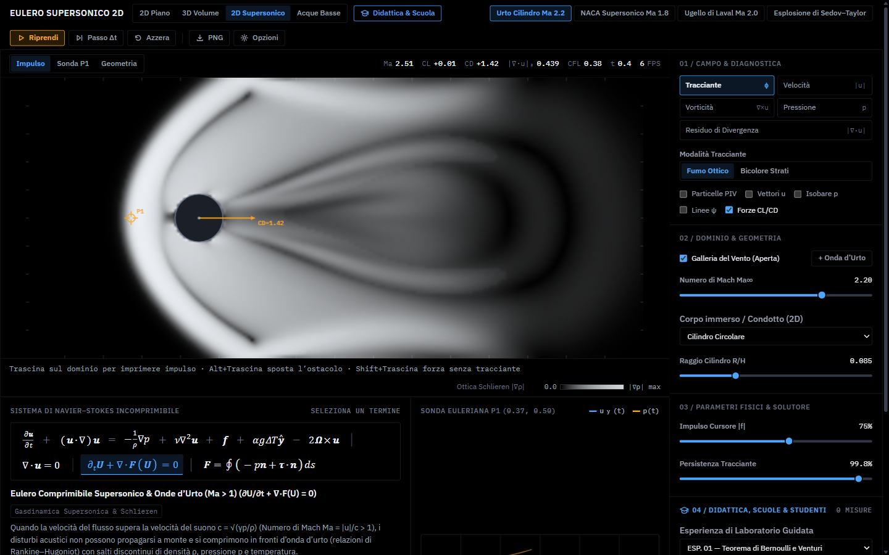
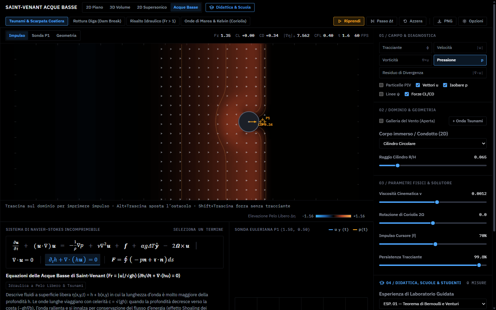
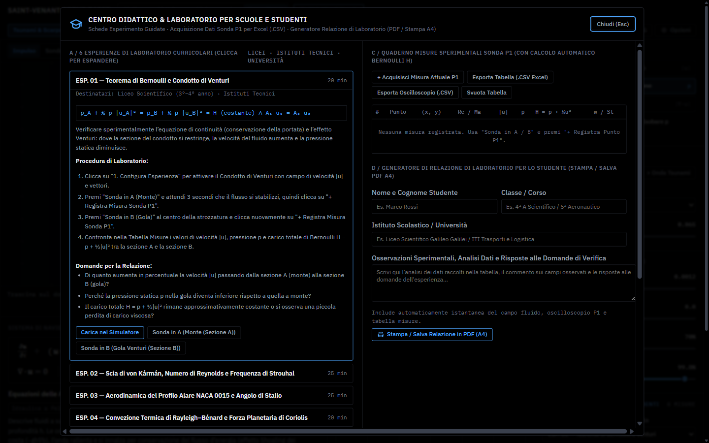
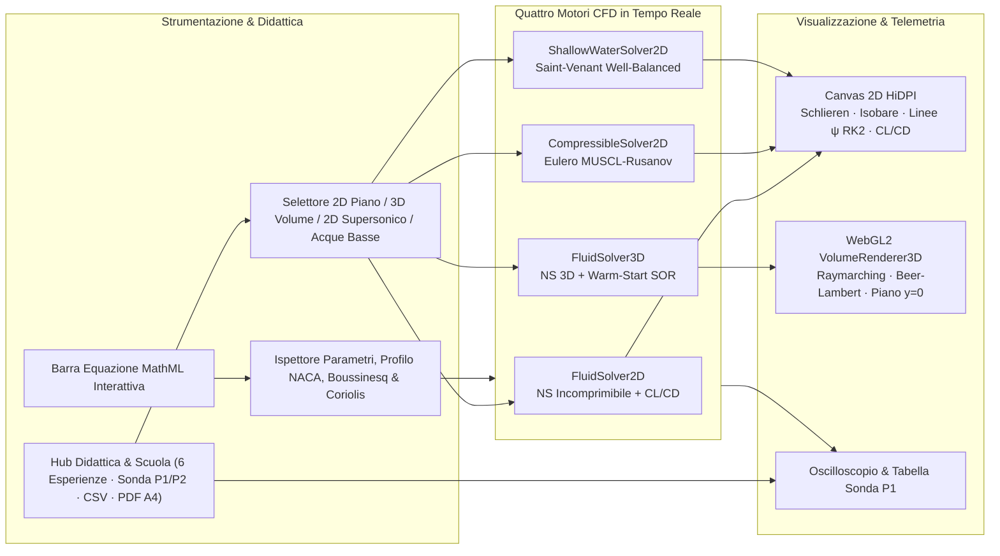

# NAVIER–STOKES 2D, 3D, SUPERSONICO & ACQUE BASSE (`navier-lab`)

**Laboratorio Didattico & Banco di Prova CFD Multi-Motore: Navier–Stokes 2D & 3D Volumetrico (WebGL2), Gasdinamica Supersonica ($Ma > 1$) e Acque Basse di Saint-Venant ($Fr$)**

[**2D Piano (Navier–Stokes) →**](https://mareknardella-lgtm.github.io/navier-lab/) · [**3D Volume (WebGL2) →**](https://mareknardella-lgtm.github.io/navier-lab/#3d) · [**2D Supersonico (Urto/Schlieren) →**](https://mareknardella-lgtm.github.io/navier-lab/#compressible) · [**Acque Basse (Saint-Venant) →**](https://mareknardella-lgtm.github.io/navier-lab/#shallow)

---

**`navier-lab`** è un laboratorio interattivo di fluidodinamica computazionale (CFD) interamente *browser-native* scritto in TypeScript puro (`Float32Array`) e `WebGL2`, progettato con l'estetica *Pure Black* (`#000000`) di uno strumento di misura da laboratorio (ispirato a *ParaView* e a *An Album of Fluid Motion* di Milton Van Dyke).

Integra **quattro solutori fisici in tempo reale** più un **Centro Didattico per Scuole e Università** (`🎓 Didattica & Scuola`):

1. **`2D Piano` — Navier–Stokes Incomprimibile + Boussinesq, Coriolis, Bilancia $C_L/C_D$ & Linee $\psi$ RK2:** avvezione MacCormack del 2° ordine, proiezione di Chorin–Helmholtz, galleggiamento termico ($\alpha g \Delta T \hat{\mathbf{y}}$), forza planetaria di Coriolis ($-2\boldsymbol{\Omega}\times\mathbf{u}$), integrazione degli sforzi aerodinamici su profili NACA/cilindri e linee di corrente RK2.
2. **`3D Volume` — Navier–Stokes Volumetrico 3D con Raymarching WebGL2 Puro:** proiezione *warm-started* SOR, stiramento tridimensionale dei tubi di vortice $(\boldsymbol{\omega}\cdot\nabla)\mathbf{u}$, illuminazione volumetrica 3D (*Beer–Lambert self-shadowing*, *Blinn–Phong*, *Fresnel rim*), ombre proiettate sul piano del pavimento $y=0$, particelle 3D prospettiche occluse dagli ostacoli e sezione tomografica opzionale.
3. **`2D Supersonico` — Gasdinamica Comprimibile ($Ma > 1$) & Ottica Schlieren:** sistema iperbolico delle equazioni di Eulero $\partial_t\mathbf{U}+\nabla\cdot\mathbf{F}(\mathbf{U})=\mathbf{0}$ con cattura delle **onde d'urto di Rankine–Hugoniot** (*Bow Shock*, urti obliqui, dischi di Mach in ugelli di De Laval, esplosione di Sedov–Taylor) e Schlieren numerica $|\nabla\rho|$.
4. **`Acque Basse` — Idrodinamica a Superficie Libera di Saint-Venant:** conservazione della quota d'acqua $h(x,y,t)$ e portata $(hu,hv)$ su batimetria variabile $b(x,y)$ con schema *well-balanced* MUSCL–Rusanov per **tsunami costieri (*shoaling*)**, **rottura diga (*Dam Break*)**, **risalto idraulico ($Fr > 1$)** e **onde di marea/Kelvin rotanti**.
5. **`🎓 Didattica & Scuola`:** 6 esperienze curricolari guidate (Licei, Istituti Tecnici e Università), acquisizione con doppia sonda differenziale `P1–P2`, calcolo automatico del carico totale di Bernoulli $H = p + \frac{1}{2}|\mathbf{u}|^2$, export `.CSV` per Excel/Calc e **generatore di Relazione di Laboratorio PDF (A4)** con istantanea e oscilloscopio inclusi.

---

## Anteprima del Laboratorio

### 1. Laboratorio Volumetrico 3D — Collisione Frontale di Anelli Toroidali (*Lim & Nickels*)
> Scontro frontale di due anelli di vortice toroidali 3D inclinati con stiramento $(\boldsymbol{\omega}\cdot\nabla)\mathbf{u}$, raymarching volumetrico WebGL2 puro (`sampler3D` senza piani 2D forzati), gradienti isotropi della densità, auto-ombreggiamento Beer–Lambert, ombre sul pavimento prospettico, particelle 3D e sonda spaziale `P1 (3D)`.

### 2. Laboratorio 2D Piano — Profilo Alare NACA 0015, Bilancia Aerodinamica ($C_L, C_D$) & Linee $\psi$ RK2
> Flusso attorno a un profilo aerodinamico NACA 0015 ad angolo d'attacco $\alpha = +14^\circ$, con vettori di Portanza ($C_L$) e Resistenza ($C_D$) integrati dal tensore degli sforzi $\mathbf{F} = \oint(-p\mathbf{n} + \boldsymbol{\tau}\cdot\mathbf{n})\,ds$, linee di corrente istantanee RK2 e ispettore dell'equazione evidenziato in basso.

### 3. Laboratorio Supersonico 2D — Onda d'Urto Staccata (*Bow Shock* $Ma = 2.2$) & Ottica Schlieren
> Flusso supersonico comprimibile ($Ma_\infty = 2.20$) su cilindro circolare: schema ai volumi finiti MUSCL–Rusanov con cattura netta dell'onda d'urto staccata di Rankine–Hugoniot, salto subsonico nello strato frontale e visualizzazione ottica Schlieren $|\nabla\rho|$ con misura diretta della resistenza d'onda $C_D$.

### 4. Laboratorio Acque Basse — Equazioni di Saint-Venant 2D (*Tsunami & Scarpata Costiera*)
> Propagazione e diffrazione di un'onda di tsunami attorno a un molo cilindrico lungo una scarpata batimetrica $-gh\nabla b$: elevazione del pelo libero $\Delta\eta$, campo vettoriale di velocità, isobate/isolivello, Numero di Froude $Fr = |\mathbf{u}|/\sqrt{gh}$ e spinta idrodinamica $C_D$ sull'ostacolo.

### 5. Hub `🎓 Didattica & Scuola` — Esperimenti Guidati, Doppia Sonda `P1/P2`, Export CSV & Relazione PDF
> Pannello didattico integrato con 6 schede esperimento complete di formule, procedura passo-passo e domande di verifica, tabella misure automatica per Bernoulli e Strouhal, esportazione CSV e stampa immediata della relazione scolastica in formato PDF A4.

---

## Formulazione Matematica & Schemi Numerici

### I. Navier–Stokes Incomprimibile 2D & 3D + Boussinesq & Coriolis
Il solutore incomprimibile integra le equazioni di Navier–Stokes accoppiate al campo termico attivo $T(\mathbf{x},t)$ e alla rotazione planetaria $\boldsymbol{\Omega}$ su griglie Euleriane uniformi ($\Delta x = \Delta y = h$ in 2D; $\Delta x = \Delta y = \Delta z = h$ su griglia $56\times 32\times 32$ in 3D):

$$\frac{\partial \mathbf{u}}{\partial t} + (\mathbf{u} \cdot \nabla)\mathbf{u} = -\frac{1}{\rho}\nabla p + \nu \nabla^2 \mathbf{u} + \underbrace{\alpha g (T - T_0)\hat{\mathbf{y}}}_{\text{Galleggiamento di Boussinesq}} \underbrace{- 2\boldsymbol{\Omega} \times \mathbf{u}}_{\text{Forza di Coriolis}} + \mathbf{f}, \qquad \nabla \cdot \mathbf{u} = 0$$

- **Avvezione MacCormack + Confinamento della Vorticità:** ricostruzione predittore-correttore con limiter min-max sugli estremi di stencil e ripristino dei nuclei vorticosi tramite $\mathbf{f}_{\text{conf}} = \varepsilon h (\mathbf{N} \times \boldsymbol{\omega})$.
- **Proiezione SOR Warm-Started (`FluidSolver3D`):** riutilizzo attenuato del potenziale di pressione $\phi^{n-1}$ come innesco iniziale del rilassamento di Poisson ($\nabla^2 p = \frac{\rho}{\Delta t}\nabla\cdot\mathbf{u}^*$), riducendo le iterazioni necessarie e preservando energia cinetica $\mathcal{E}$ e anelli toroidali sottili.
- **Forza di Coriolis con Rotazione Esatta:** rotazione trigonometrica puntuale che conserva al 100% l'energia cinetica discreta su piano $\beta$ geofisico.

### II. Gasdinamica Supersonica Comprimibile 2D (`CompressibleSolver2D` — $Ma > 1$)
Il solutore supersonico risolve il sistema iperbolico conservativo delle **equazioni di Eulero comprimibili 2D** per $\mathbf{U} = (\rho, \rho u, \rho v, E)^T$:

$$\frac{\partial \mathbf{U}}{\partial t} + \frac{\partial \mathbf{F}(\mathbf{U})}{\partial x} + \frac{\partial \mathbf{G}(\mathbf{U})}{\partial y} = \mathbf{0}, \qquad p = (\gamma - 1)\!\left(E - \tfrac{1}{2}\rho(u^2 + v^2)\right), \quad \gamma = 1.4$$

- **Volumi Finiti Shock-Capturing (MUSCL + Rusanov):** ricostruzione lineare del 2° ordine con limitatore di pendenza **minmod** (TVD) e flussi numerici di **Rusanov** con velocità caratteristica $\lambda_{\max} = |\mathbf{u}\cdot\mathbf{n}| + c$ ($c = \sqrt{\gamma p / \rho}$).
- **Ottica Schlieren Numerica $|\nabla\rho|$:** mappatura esponenziale $1 - \exp(-k|\nabla\rho|)$ per visualizzare *bow shock*, urti obliqui, ventagli di Prandtl–Meyer e dischi di Mach.

### III. Acque Basse di Saint-Venant 2D (`ShallowWaterSolver2D`)
Per flussi geofisici e idraulici a superficie libera dove la scala orizzontale domina la profondità $h(x,y,t) = \eta(x,y,t) - b(x,y)$, il solutore integra le **equazioni delle acque basse (Shallow Water)** su batimetria variabile $b(x,y)$:

$$\frac{\partial h}{\partial t} + \nabla\cdot(h\mathbf{u}) = 0, \qquad \frac{\partial (h\mathbf{u})}{\partial t} + \nabla\cdot\!\left(h\mathbf{u}\otimes\mathbf{u} + \tfrac{1}{2}gh^2\mathbf{I}\right) = -gh\nabla b - f\hat{\mathbf{z}}\times(h\mathbf{u}) - c_f\mathbf{u}|\mathbf{u}|$$

- **Ricostruzione Idrostatica *Well-Balanced*:** preserva esattamente gli stati di quiete su fondo inclinato (*lake at rest*) gestendo al contempo fronti d'onda discontinui (*bore* da crollo diga, risalti idraulici da $Fr > 1$ a $Fr < 1$) con flussi MUSCL–Rusanov e numero di Froude locale $Fr = |\mathbf{u}|/\sqrt{gh}$.

### IV. Bilancia Aerodinamica ($C_L, C_D$) e Linee di Corrente RK2
- **Sforzi Superficiali Integrati (`computeAeroForces`):** calcola in tempo reale la risultante di pressione normale e sforzo viscoso tangenziale sul contorno dell'ostacolo immerso (profilo NACA, cilindro, sfera, pilone idraulico):
  $$\mathbf{F} = \oint_{\partial\Omega_s} \!\left(-p\mathbf{I} + \mu\bigl(\nabla\mathbf{u} + \nabla\mathbf{u}^T\bigr)\right)\!\cdot\mathbf{n}\,ds, \qquad C_L = \frac{F_y}{\tfrac{1}{2}\rho U_\infty^2 D}, \qquad C_D = \frac{F_x}{\tfrac{1}{2}\rho U_\infty^2 D}$$
- **Linee di Corrente RK2 (`drawStreamlines`):** traccia curve istantanee tangenti al campo $\mathbf{u}$ integrando con metodo di Runge–Kutta del 2° ordine (*midpoint*).

### V. Rendering Volumetrico 3D (`VolumeRenderer3D` — WebGL2)
- **Raymarching a 76 passi con *Empty-Space Skipping*:** campionamento trilineare nativo `TEXTURE_3D`, gradiente fisico 3D della densità per la normale superficiale, ombreggiatura volumetrica direzionale di **Beer–Lambert** ($I_{\text{sh}} = \exp(-\sigma \sum \rho)$), illuminazione emisferica + speculare **Blinn–Phong** + bordo di **Fresnel** + nucleo luminoso.
- **Contesto 3D & Occlusione:** piano di appoggio calibrato a $y = 0$ con ombre proiettate sia dal volume fluido sia dall'ostacolo 3D, sfera/cubo ombreggiati analiticamente, gabbia con attenuazione di profondità e particelle Lagrangiane 3D dimensionate prospetticamente ($1/z_{\text{cam}}$) e occluse dall'ostacolo.

---

## Architettura Funzionale del Laboratorio

---

## Scenari Preconfigurati & Schede Didattiche

### 1. Laboratorio 2D Piano (`2D Piano`)
| Scenario 2D | Geometria | Regime Fisico | Fenomeno Osservabile |
| :--- | :--- | :--- | :--- |
| **Scia di Kármán** | Cilindro circolare ($D/H = 0.15$) | $Re \approx 190$–$420$ | Instabilità di scia e distacco periodico di vortici alternati ($St \approx 0.17$–$0.20$) |
| **NACA 0015** | Profilo alare ($c/H = 0.26$, $\alpha = +14^\circ$) | $Re \approx 980$ | Ristagno frontale, depressione dorsale, vettori $C_L/C_D$ e linee di corrente RK2 |
| **Venturi** | Strozzatura sinusoidale simmetrica | Flusso confinato | Accelerazione assiale nella gola ($\nabla\cdot\mathbf{u}=0$) e caduta di pressione di Bernoulli |
| **Rayleigh–Bénard** | Cavità riscaldata dal basso | Convezione di Boussinesq | Piume termiche ascendenti a fungo, celle convettive e vorticità baroclina |
| **Getto di Coriolis** | Getto zonale in rotazione | Piano $\beta$ geofisico | Deflessione ciclonica/anticiclonica di Coriolis e meandri di Rossby |
| **Collisione Dipoli** | Dominio chiuso libero | Quasi-inviscido ($\nu \to 0$) | Interazione frontale di due dipoli vorticosi controrotanti |
| **Flusso di Stokes** | Cilindro circolare | $Re \ll 10$ (alta $\nu$) | Flusso laminare rampicante reversibile dominato dalla viscosità |

### 2. Laboratorio 3D Volumetrico (`3D Volume`)
| Scenario 3D | Geometria / Inizializzazione | Regime Fisico | Fenomeno Osservabile |
| :--- | :--- | :--- | :--- |
| **Collisione Anelli 3D** | Due anelli toroidali 3D inclinati frontali | Quasi-inviscido ($Re \gg 10^3$) | Scontro frontale, stiramento radiale $(\boldsymbol{\omega}\cdot\nabla)\mathbf{u}$ e riconnessione 3D (*Lim & Nickels*) |
| **Anello Toroidale 3D** | Singolo anello toroidale inclinato | Dominio 3D chiuso | Propagazione auto-indotta per legge di Biot–Savart con nucleo vorticoso $|\boldsymbol{\omega}|$ |
| **Sfera in Galleria 3D** | Sfera analitica 3D + 9 ugelli elicoidali | Galleria del vento 3D | Bolla di ricircolo toroidale a valle della sfera e distacco di scia tridimensionale a forcina |
| **Piuma Termica 3D** | Sorgente calda circolare alla base $y=0$ | Convezione 3D di Boussinesq | Piuma termica 3D ascendente che si avvolge in un cappello a fungo toroidale |
| **Vortice Taylor–Green 3D** | 4 tubi di vortice 3D non complanari | Decadimento turbolento | Stiramento dei tubi di vortice, picco di enstrofia $\mathcal{E}$ e cascata 3D |

### 3. Laboratorio Supersonico 2D (`2D Supersonico` — Eulero $Ma > 1$)
| Scenario Supersonico | Geometria | Regime di Mach | Fenomeno Osservabile |
| :--- | :--- | :--- | :--- |
| **Urto Cilindro Ma 2.2** | Cilindro smusso ($D/H = 0.17$) | $Ma_\infty = 2.20$ | Onda d'urto staccata (*Bow Shock*), strato subsonico frontale e resistenza d'onda $C_D$ |
| **NACA Supersonico Ma 1.8** | Profilo alare ($\alpha = +8^\circ$) | $Ma_\infty = 1.80$ | Urti obliqui al bordo d'attacco, ventagli di espansione di Prandtl–Meyer e campo $Ma(x,y)$ |
| **Ugello di Laval Ma 2.0** | Condotto convergente-divergente | Transonico $\to Ma \approx 2$ | Accelerazione sonica in gola ($Ma=1$) e treno di dischi d'urto (*Shock Diamonds*) |
| **Esplosione di Sedov–Taylor** | Detonazione puntiforme centrale | Urto forte ($\Delta p / p_\infty \gg 1$) | Onda d'urto cilindrica auto-simile con riflessioni multiple sulle pareti |

### 4. Laboratorio Acque Basse (`Acque Basse` — Saint-Venant)
| Scenario Acque Basse | Batimetria / Geometria | Regime di Froude | Fenomeno Osservabile |
| :--- | :--- | :--- | :--- |
| **Tsunami & Scarpata Costiera** | Piattaforma continentale + molo cilindrico | Transizione profondo $\to$ costa | Innalzamento d'onda (*shoaling* $-gh\nabla b$) e diffrazione attorno al pilone |
| **Rottura Diga (Dam Break)** | Dislivello idrostatico + ostacolo | Problema di Riemann | Fronte d'onda a gradino (*bore*) propagante a valle e onda di rarefazione a monte |
| **Risalto Idraulico (Fr > 1)** | Canale aperto con corrente veloce | Supercritico $\to$ subcritico | Transizione brusca da flusso veloce ($Fr > 1$) a lento ($Fr < 1$) con dissipazione |
| **Onde di Marea & Kelvin (Coriolis)** | Bacino chiuso rotante ($2\Omega > 0$) | Geofisico rotante | Onde di gravità-inerzia (*Poincaré/Kelvin*) intrappolate lungo i bordi e flusso geostrofico |

### 5. Esperienze Guidate in `🎓 Didattica & Scuola`
- **ESP. 01** — *Teorema di Bernoulli e Condotto di Venturi* (`Liceo Scientifico · Istituti Tecnici`)
- **ESP. 02** — *Scia di von Kármán, Numero di Reynolds e Frequenza di Strouhal* (`Licei · Fisica I · Fluidodinamica`)
- **ESP. 03** — *Aerodinamica del Profilo Alare NACA 0015 e Angolo di Stallo* (`Istituti Tecnici Aeronautici · Ingegneria`)
- **ESP. 04** — *Convezione Termica di Rayleigh–Bénard e Forza Planetaria di Coriolis* (`Scienze della Terra · Fisica dell'Atmosfera`)
- **ESP. 05** — *Gasdinamica Supersonica ($Ma > 1$), Onde d'Urto e Ottica Schlieren* (`Istituti Aeronautici · Aerospaziale`)
- **ESP. 06** — *Acque Basse di Saint-Venant: Onde di Tsunami, Diga e Numero di Froude* (`Istituti CAT · Ingegneria Civile & Idraulica`)

---

## Accesso ed Esecuzione (Esclusivamente via Browser Web)

Il laboratorio è fruibile direttamente online **esclusivamente nel browser web**, senza alcuna installazione locale:

- **2D Piano (Incomprimibile + $C_L/C_D$ & RK2):** [https://mareknardella-lgtm.github.io/navier-lab/](https://mareknardella-lgtm.github.io/navier-lab/)
- **3D Volume (Raymarching Volumetrico WebGL2):** [https://mareknardella-lgtm.github.io/navier-lab/#3d](https://mareknardella-lgtm.github.io/navier-lab/#3d)
- **2D Supersonico (Onde d'Urto & Ottica Schlieren):** [https://mareknardella-lgtm.github.io/navier-lab/#compressible](https://mareknardella-lgtm.github.io/navier-lab/#compressible)
- **Acque Basse (Saint-Venant & Tsunami):** [https://mareknardella-lgtm.github.io/navier-lab/#shallow](https://mareknardella-lgtm.github.io/navier-lab/#shallow)

---

## Licenza e Protezione della Proprietà Intellettuale

**Copyright © 2026 Marek Nardella — Tutti i diritti riservati ([`LICENSE`](./LICENSE)).**

- **Solo Utilizzo Online via Browser:** È consentita unicamente la fruizione interattiva tramite browser web sull'istanza ufficiale.
- **Divieto di Installazione e Copia:** È vietato scaricare, installare localmente, eseguire offline (`file://`), incapsulare come app/PWA o ridistribuire il software su domini terzi.
- **Divieto di Reverse Engineering:** Il software integra misure di offuscamento e protezione runtime contro decompilazione, estrazione degli algoritmi numerici e reverse engineering. Per licenze didattiche/scolastiche o commerciali contattare il titolare dei diritti.
